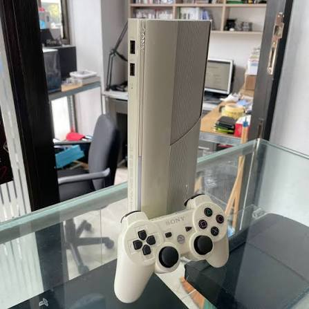
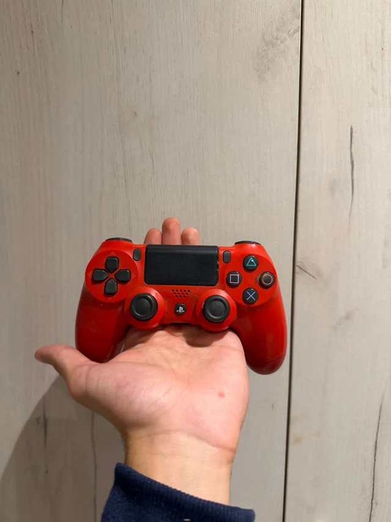
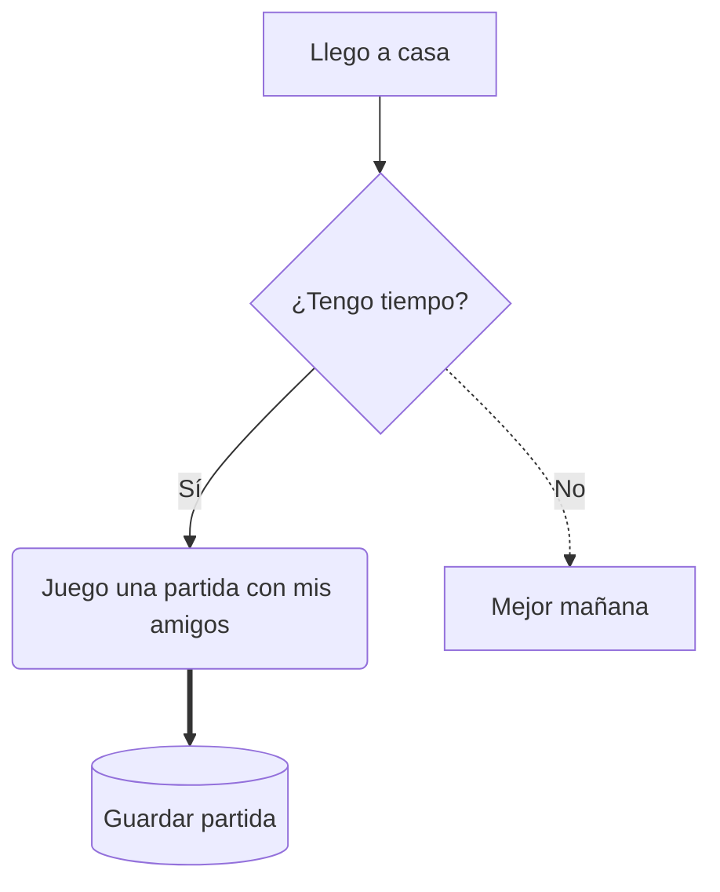
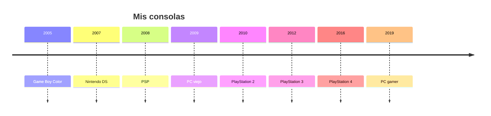
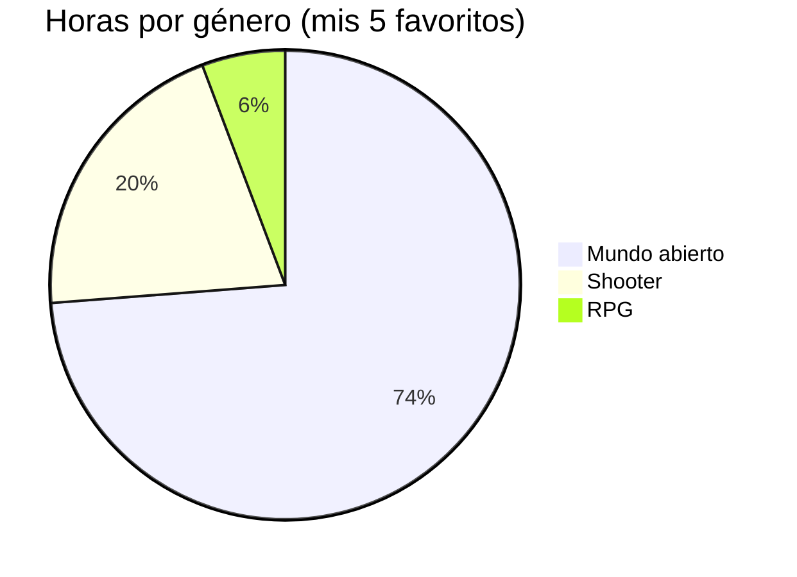
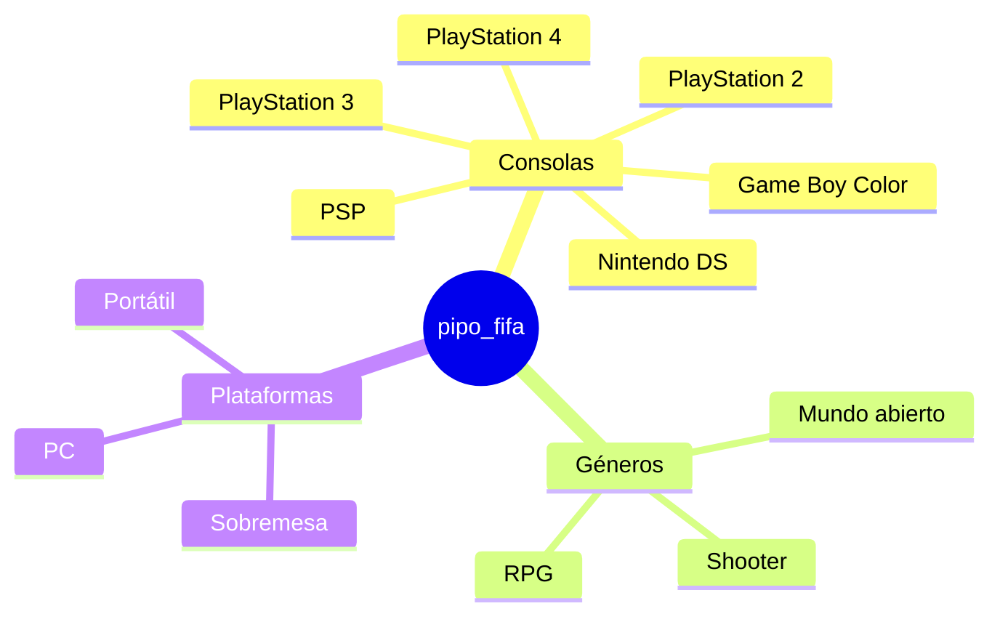
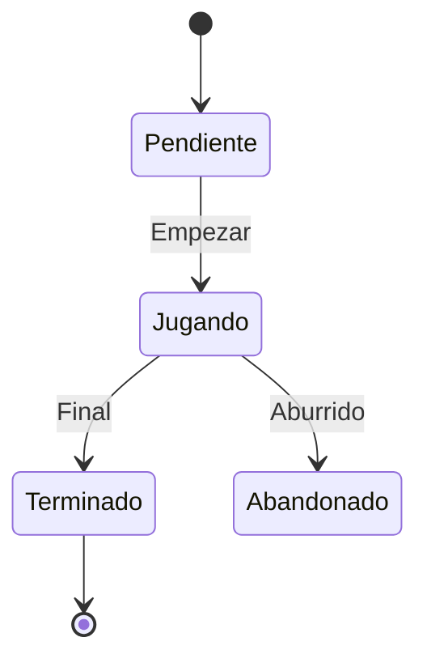

<!--
  README.md · AE01_07 · Markdown
  Autor: Simone Monzani Estevez (pipo_fifa)
  Tema: Videojuegos que he jugado y videoconsolas que he tenido
  (Este es un comentario de Markdown: NO se ve en GitHub, solo en el código)
-->

<div align="center">


### 🎮 Mi historia gamer: videojuegos y videoconsolas 🕹️

Proyecto AE01_07 · por **Simone Monzani Estevez** (*pipo_fifa*)

</div>

---

# Índice

1. [Introducción](#introducción "Ir a la introducción")
2. [Mis videoconsolas](#mis-videoconsolas "Ir a mis videoconsolas")
3. [Mis videojuegos](#mis-videojuegos "Ir a mis videojuegos")
4. [Fórmulas y estadísticas](#fórmulas-y-estadísticas "Ir a las fórmulas")
5. [Diagramas](#diagramas "Ir a los diagramas")
6. [Enlaces e imágenes](#enlaces-e-imágenes "Ir a los enlaces")
7. [Conclusión](#conclusión "Ir a la conclusión")

[⬆️ Volver al índice](#índice "Volver al índice")

---

# Introducción

[⬆️ Volver al índice](#índice "Volver al índice")

## 🎯 Sobre este proyecto

Hola, soy **Simone Monzani Estevez**, tengo 23 años y en el mundo gamer me conocen como **pipo_fifa**. 🎮\
Este documento recoge los juegos que he jugado\
y las consolas que he tenido a lo largo de mi vida.

## 🏷️ ¿Por qué *pipo_fifa*?

Mi padre me llamaba **Pipo** por el futbolista Pippo Inzaghi, y **FIFA 08** fue mi primer juego de la PS3.\
Cuando fui a crearme la cuenta de PlayStation, junté las dos cosas y nació mi nick. ⚽

## 🕹️ Cómo empecé

Todo empezó con un **ordenador viejo** y el clásico **pinball**. Después llegaron las consolas portátiles, como la *Game Boy Color*, la *Nintendo DS* y la *PSP*,\
y más tarde las PlayStation, que marcaron mi adolescencia.\
Hoy en día juego sobre todo en mi **PC gamer** con mis amigos de toda la vida.

Mi juego favorito es ***GTA V***, con más de 3000 horas. En el proyecto los que menos me han gustado, como ~~Subnautica~~, los tacho.

---

### ✍️ Formatos de texto

#### Cómo marco las cosas en este documento

- **Negrita** para las consolas y los datos importantes.
- *Cursiva* para los títulos de los juegos.
- ***Negrita cursiva*** para mis juegos favoritos.
- ~~Tachado~~ para los juegos que no me han gustado.

#### Caracteres especiales

\*pipo_fifa\* &rarr; así me conocen en PlayStation &copy; 2026 🕹️

***

> [!NOTE]
> Las horas que pongo de cada juego son aproximadas: nunca he llevado la cuenta exacta.

> [!TIP]
> Antes de empezar una misión larga en *GTA V* o en *Red Dead*, guarda la partida.

> [!WARNING]
> Cuidado: *GTA V* me ha robado más de 3000 horas. 😴

> “Solo quiero que el mundo sepa que estuve aquí. Que importé.”
>
> — **V**, protagonista de *Cyberpunk 2077*

---

# Mis videoconsolas

[⬆️ Volver al índice](#índice "Volver al índice")

## 📺 Tabla de consolas

| Consola            | Año en que la tuve | Mi nota |
|:-------------------|:------------------:|--------:|
| Game Boy Color     | 2005               | 6/10    |
| Nintendo DS        | 2007               | 9/10    |
| PSP                | 2008               | 9/10    |
| PC viejo           | 2009               | 7/10    |
| PlayStation 2      | 2010               | 8/10    |
| **PlayStation 3**  | 2012               | 10/10   |
| PlayStation 4      | 2016               | 9/10    |
| PC gamer           | 2019               | 9/10    |

## 📋 Mi recorrido por etapas

1. Infancia
   - Pinball en un ordenador viejo
   - Game Boy Color
   - Nintendo DS
2. Adolescencia
   1. PSP
   2. PlayStation 2
   3. PlayStation 3
   4. PlayStation 4
3. Actualidad
   - PC gamer
   - PSP (¡la sigo usando!)

## ⭐ Mi consola favorita

La **PlayStation 3** es mi favorita: marcó mi adolescencia y me dio muchísimos juegos nuevos y recuerdos que nunca olvidaré.

## 🖼️ Imágenes de mis consolas

Imágenes de Internet:

<div align="center">


</div>

Fotos mías, guardadas en la carpeta `img` del proyecto:

<p align="center">
  
  
  
</p>

### 🧩 Más sobre mi consola favorita

<details>
<summary>🔬 Pulsa para ver detalles de mi consola favorita</summary>

<p>
  <strong>Consola:</strong> PlayStation 3
</p>
<p>
  <strong>Por qué me gusta:</strong> marcó mi adolescencia, fue donde más jugué y donde conseguí muchos recuerdos bonitos.
</p>

</details>

<p align="center">
  <b>🎮 La PS3 fue mi mejor consola 🎮</b>
</p>

---

# Mis videojuegos

[⬆️ Volver al índice](#índice "Volver al índice")

## 🏆 Mis juegos favoritos

| Juego                | Género                  | Horas   |
|:---------------------|:-----------------------:|--------:|
| ***GTA V***          | Mundo abierto           | +3000   |
| ***Black Ops 2***    | Shooter (FPS)           | 1250    |
| ***GTA IV***         | Mundo abierto           | +1000   |
| ***Red Dead Redemption 2*** | Mundo abierto / Western | 500 |
| ***Cyberpunk 2077*** | RPG de acción           | 350     |

## ⏱️ Horas por consola

No llevo la cuenta exacta, así que lo resumo según cuánto he usado cada una:

| Consola         | Cuánto la he usado                                   |
|:----------------|:-----------------------------------------------------|
| Game Boy Color  | Poco                                                 |
| Nintendo DS     | Bastante: unos 4 años                                |
| PSP             | Bastante, y todavía la uso hoy                       |
| PC viejo        | Algunos años, hasta que llegó la PS2                 |
| PlayStation 2   | Mediano: aproveché mucho más la PS3                  |
| PlayStation 3   | **Muchísimo: la que más he jugado, con diferencia**  |
| PlayStation 4   | La 2.ª consola que más he jugado                     |
| PC gamer        | En uso: para jugar y para las clases                 |

## ✅ Lista de tareas: juegos terminados y pendientes

- [x] *GTA IV* y *GTA V*
- [x] Casi todos los *Assassin's Creed*
- [x] Los dos *Red Dead*
- [x] *Fortnite*
- [x] *Uncharted*
- [x] *Cyberpunk 2077*
- [x] Casi todos los *FIFA* y los *Call of Duty*
- [x] Casi todos los *Battlefield*
- [x] *Spider-Man*
- [x] Los *Mafia*
- [x] *L.A. Noire*
- [ ] Acordarme del resto de juegos que he terminado y añadirlos aquí

## 👎 Juegos que no me han gustado

- ~~Alguno de *Pokémon*~~
- ~~*Subnautica*~~
- ~~*Call of Duty: Ghosts*~~

## 💻 Código

Mi nick es `pipo_fifa` y mi consola favorita es la `PS3`.

Estas son las consolas que más he usado, en una lista:

```markdown
- PlayStation 3
- PlayStation 4
- PSP
```

Y esta es la frase con la que me despido de mis amigos cuando terminamos de jugar:

```html
<p align="center">¡Nos vemos en la próxima partida!</p>
```

## 🍀 Mi recuerdo gamer más especial

Estaba de vacaciones en **Italia** y me encontré un **trébol de cuatro hojas**. Pedí una videoconsola como deseo… y ese mismo día me regalaron la **PlayStation 2**. 🎁

## 👥 Con quién juego hoy

Hoy juego principalmente en **PC** con mis **amigos de toda la vida**. 🖥️

## 💬 Cita

> En mi tarjeta de visita soy presidente de una empresa. En mi mente soy desarrollador de videojuegos. Pero en mi corazón soy un jugador.
>
> — **Satoru Iwata**, expresidente de Nintendo (GDC 2005)

---

# Fórmulas y estadísticas

[⬆️ Volver al índice](#índice "Volver al índice")

## 📊 Estadística: media de horas

La media de horas por juego es $\bar{x} = \frac{1}{n}\sum_{i=1}^{n}x_i$ (fórmula en línea).

Con mis 5 juegos favoritos (usando 1000 y 3000 horas como mínimo para GTA IV y GTA V):

$$
\bar{x} = \frac{1000 + 3000 + 500 + 1250 + 350}{5} = 1220 \text{ horas}
$$

## 🏅 Trofeos de PlayStation

En PlayStation tengo **1258** trofeos de bronce, **556** de plata, **350** de oro y **27** de platino. En total:

$$
T = 1258 + 556 + 350 + 27 = 2191 \text{ trofeos}
$$

El porcentaje de trofeos de platino es $\text{Platino} = \frac{P}{T} \cdot 100$ y, en mi caso, $\frac{27}{2191} \cdot 100 \approx 1.23\%$.

## 🚗 Física: el salto de un personaje en *GTA V*

La altura del salto en un instante $t$ es:

$$
y(t) = v_0 t - \frac{1}{2} g t^2
$$

## ⚔️ Daño crítico en *Cyberpunk 2077*

$$
\text{Daño} = \begin{cases}
A \cdot 2 & \text{si es crítico} \\
A & \text{si no es crítico}
\end{cases}
$$

## 🎲 Probabilidad: objeto raro

Si un objeto aparece con probabilidad $p$, la probabilidad de conseguirlo al menos una vez en $n$ intentos es $P = 1 - (1-p)^n$.

## 🗺️ Geometría: distancia entre dos puntos del mapa de *GTA V*

$$
d = \sqrt{(x_2 - x_1)^2 + (y_2 - y_1)^2}
$$

---

# Diagramas

[⬆️ Volver al índice](#índice "Volver al índice")

## 🔀 Diagrama de flujo: ¿juego hoy?



## 📅 Línea de tiempo de mis consolas



## 🥧 Diagrama de pastel: géneros por horas jugadas



## 🧠 Mapa mental



## 🔄 Diagrama de estado: ciclo de un juego



---

# Enlaces e imágenes

[⬆️ Volver al índice](#índice "Volver al índice")

## 🌐 Enlaces externos

- [PlayStation](https://www.playstation.com "Web oficial de PlayStation")
- [Rockstar Games](https://www.rockstargames.com "Web oficial de Rockstar Games")
- [HowLongToBeat](https://howlongtobeat.com "Cuánto dura cada videojuego")
- [Videojuego en Wikipedia](https://es.wikipedia.org/wiki/Videojuego "Artículo de Wikipedia")

## 📁 Enlaces a archivos del proyecto

- Consulta la carpeta de fotos [fotos proyecto](fotos/ "Abrir la carpeta fotos").
- Mira mi [mando favorito](img/mando.jpg "Abrir la imagen del mando").

## 🔗 Enlaces dentro del documento

- Ir a la [tabla de consolas](#-tabla-de-consolas "Ir a la tabla de consolas")
- Ir a las [fórmulas](#fórmulas-y-estadísticas "Ir a las fórmulas")
- Ir al [índice](#índice "Volver al índice")

---

# Conclusión

[⬆️ Volver al índice](#índice "Volver al índice")

Los videojuegos han sido una parte muy importante de mi vida, desde el pinball de un ordenador viejo hasta mi PC gamer. 🕹️\
Con este README he practicado muchos elementos de **Markdown**.

> [!IMPORTANT]
> Gracias por leer mi historia gamer. 🎮

<p align="center">Hecho con ❤️ y Markdown · &copy; 2026 Simone Monzani Estevez (pipo_fifa)</p>
